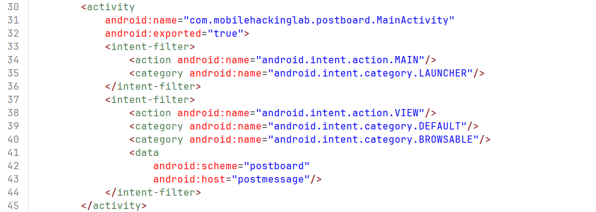
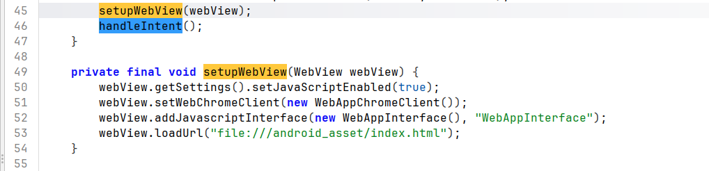
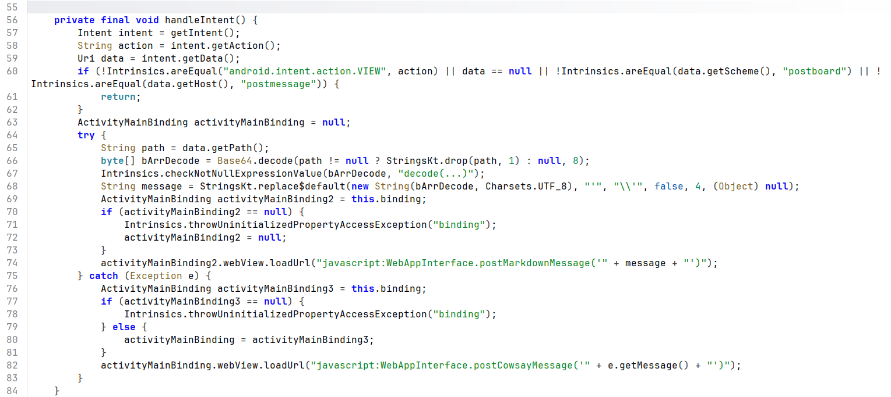
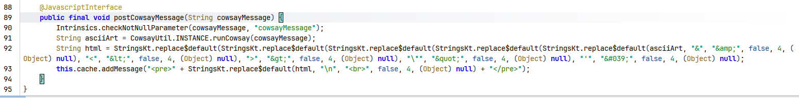
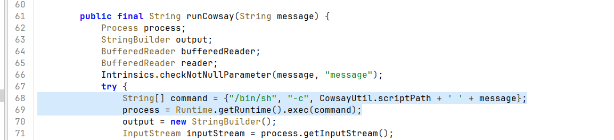
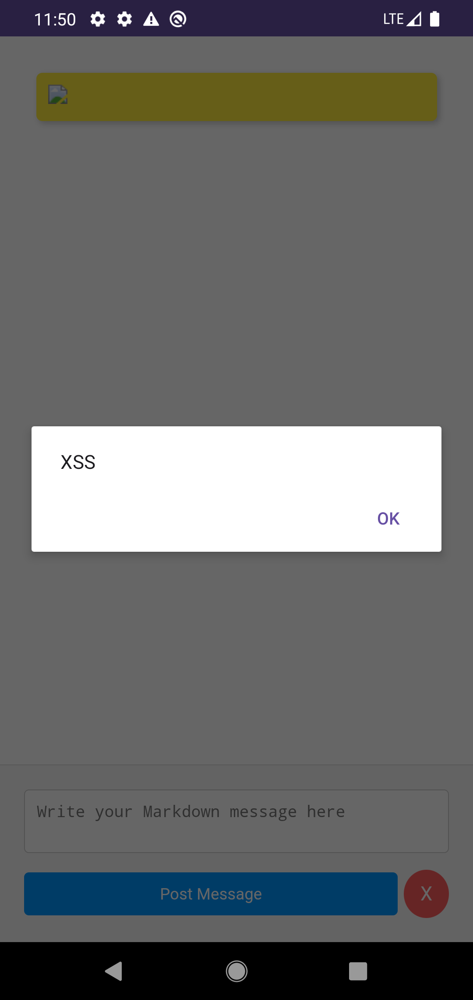
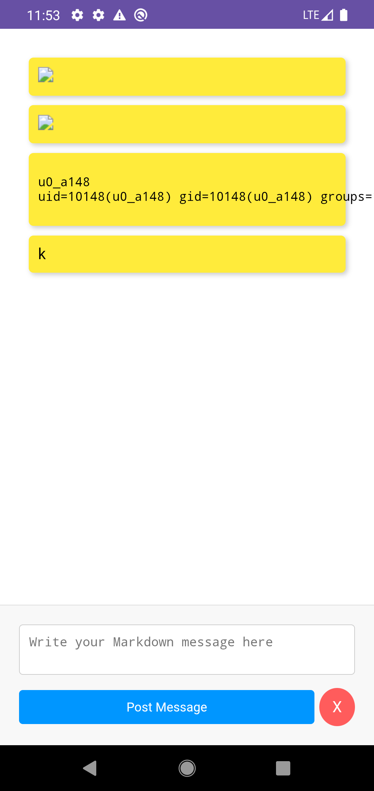
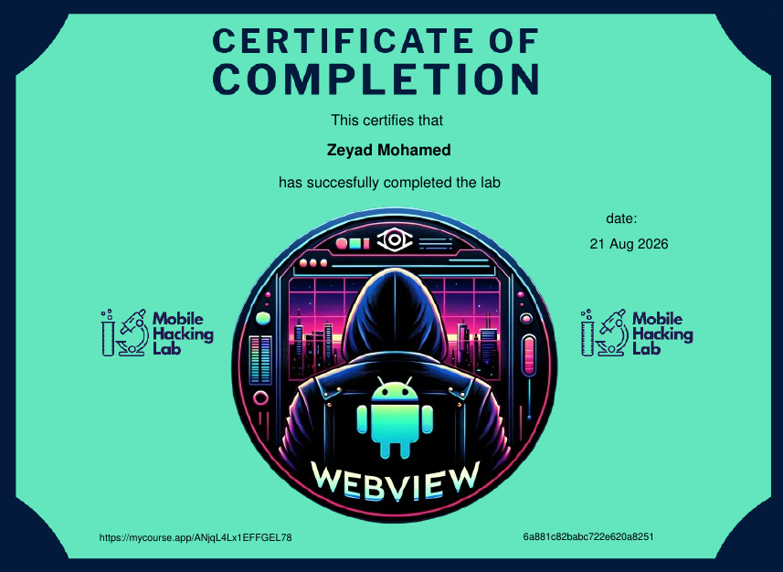

# Objection
Exploit an XSS vulnerability in a WebView component to achieve RCE in an Android application.

# Static Analysis

### AndroidManifest.xml Reconnaissance

We began by examining the `AndroidManifest.xml` file to understand the application's entry points.



**Key observations:**

- Only one activity is declared: `MainActivity`
- The activity is **exported** and defines an `<intent-filter>` with `action VIEW`
- This indicates the activity can be invoked externally via deep links, and it likely hosts a WebView

### Decompiling MainActivity

Moving to the `MainActivity` source code, we found the lifecycle setup:


The activity initializes the UI and calls two critical methods:
- `setupWebView(webView)`
- `handleIntent()`

Inside `setupWebView()`, the WebView is configured and loads `index.html` from the local assets:

A key detail emerges here: the application uses `innerHTML` to render messages. This is a classic sink for XSS if an attacker can control the message content.

#### Intent Handling Logic

The `handleIntent()` method processes incoming intents:

The logic extracts the following from the intent:
- **Action**
- **Scheme**
- **Host**
- **Message** (extracted from the URI path)



If all checks pass, it calls `postMarkdownMessage()` with the extracted message. The implementation of this call is:

```java
activityMainBinding2.webView.loadUrl("javascript:WebAppInterface.postMarkdownMessage('" + message + "')");
```
In case of an exception, it falls back to:
```java
activityMainBinding.webView.loadUrl("javascript:WebAppInterface.postCowsayMessage('" + e.getMessage() + "')");
```


### WebAppInterface Analysis

The `WebAppInterface` class exposes several JavaScript-callable methods:

The relevant methods are:

- `getMessages()` – reads cached messages and print them into UI
- `clearCache()` – clears message cache 
- `postMarkdownMessage(String markdownMessage)` – applies regex filtering and adds messages to cache
- `postCowsayMessage(String cowsayMessage)` – invokes `runCowsay()` with the input





The `runCowsay()` method is particularly interesting:
```java

String[] command = {"/bin/sh", "-c", CowsayUtil.scriptPath + ' ' + message};  
process = Runtime.getRuntime().exec(command);
```

This executes a shell command built from the user-supplied `message`. **This is a clear command injection vulnerability.** 
However, there is a crucial catch: `postCowsayMessage()` is **never called** directly by the application's Java code. The only way to trigger it is via the JavaScript bridge – which brings us to the XSS vector !

# Exploitation

### Step 1: Trigger XSS

We first tested the XSS sink by injecting a classic payload . The application renders the message using `innerHTML`, so our payload executed successfully:

`You can use an intent and add the payload as a path, and don't forget to encode it with Base64. But to make it easier, I send it automatically in the chat, and that will make the whole process automatic.`

```js

```


It works, now it's time to call the postCowsayMessage() so let's update the payload:
```Js

```
Nothing happened, but if we send any message after that, the first alert will fire and the new message with the response of the command. That's happened when it read the cache again and got the message.



# Impact

Successful exploitation of this vulnerability chain allows an attacker to execute arbitrary shell commands on the target Android device with the privileges of the application. This can lead to:

- **Full device compromise** – The attacker can read, modify, or delete sensitive user data stored on the device, including contacts, messages, and files.
    
- **Persistence** – By installing a backdoor or injecting malicious code, the attacker can maintain long‑term access.
    
- **Lateral movement** – The compromised device can be used as a foothold to attack other devices on the same network.
    
- **Privilege escalation** – If the application runs with elevated permissions (e.g., `android.permission.READ_EXTERNAL_STORAGE`, `INTERNET`, etc.), the attacker inherits those permissions, potentially accessing camera, microphone, or location data.
    
- **Data exfiltration** – The attacker can silently upload sensitive information to a remote server.
    
- **Remote shell** – A reverse shell can be established, granting interactive control over the device.

# Mitigation

To prevent this vulnerability chain, the following measures should be implemented:

1. **Sanitize WebView input** – Avoid using `innerHTML` with untrusted data. Use `textContent` or implement proper HTML escaping to prevent XSS.
    
2. **Secure the JavaScript bridge** – Annotate exposed methods with `@android.webkit.JavascriptInterface` and avoid exposing sensitive functionality that executes system commands.
    
3. **Validate intents rigorously** – Implement strict whitelisting for allowed schemes, hosts, and path patterns. Reject any malformed or unexpected inputs.
    
4. **Harden WebView configuration** – Disable JavaScript for untrusted content and restrict file access (`setAllowFileAccess(false)`).
    
5. **Avoid command injection** – Never concatenate user input into shell commands. Use `ProcessBuilder` with properly sanitized argument lists.

# Conclusion

This vulnerability chain—combining an exported activity, an XSS-prone WebView, and an insecure JavaScript bridge—enables remote attackers to achieve RCE on the target device. The root cause is insufficient input validation across multiple layers of the application. Implementing defense-in-depth with proper sanitization, secure configuration, and restricted interface exposure would effectively mitigate this attack vector.


