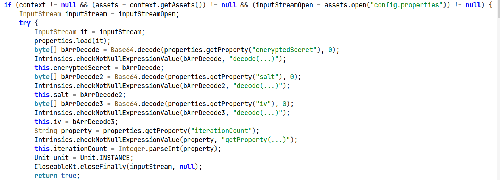
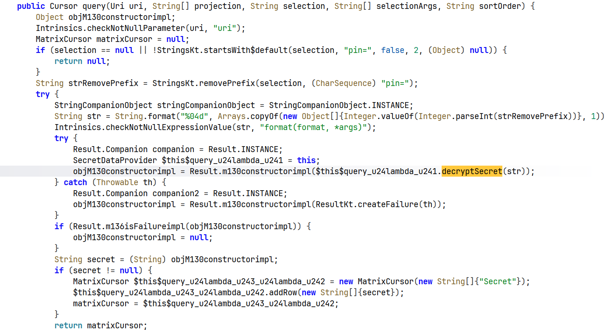
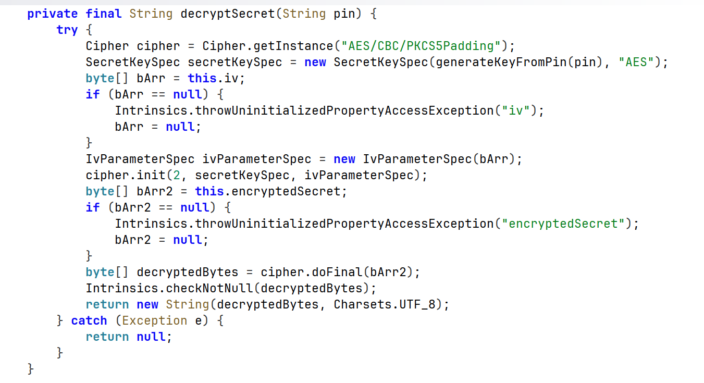
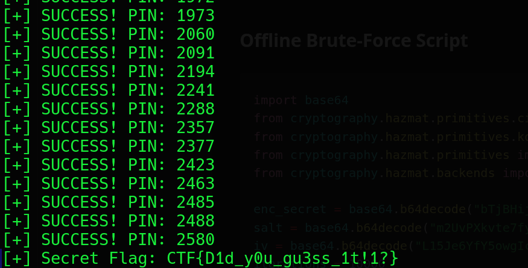

## Objctive

Retrieve a PIN code and the underlying cleartext secret from a secured Content Provider in an Android application by reverse-engineering the cryptographic implementation and performing an offline brute-force attack.

## 1. Vulnerability Discovery & Static Analysis

The assessment began with an inspection of the `AndroidManifest.xml to identify the application's attack surface. The manifest revealed an exported Content Provider, meaning any other application installed on the device could potentially interact with it.




Decompiling the target Content Provider and examining the `onCreate()` method revealed how the application initializes its secure state. The provider reads an XML file (or properties file) named `config.properties` and extracts three critical cryptographic parameters:

- `salt`
- `iv` (Initialization Vector)
- `encryptedSecret`
These variables are stored as class attributes for later use.


 

Next, the `query()` method  was analyzed to understand how user input is processed. The provider expects an input string via the `selection` parameter (e.g., `pin=1234`).

1. It sanitizes the input by stripping the `pin=` prefix.
2. It parses the remaining string as an integer, inherently enforcing a numeric structure.
3. It reformats the integer back into a strict 4-digit string format (e.g., `0123`).
4. Finally, it passes this 4-digit PIN into the `decryptSecret()` method.




The `decryptSecret()` method handles the core cryptography. It passes the 4-digit PIN to a `generateKeyFromPin()` function, which derives an encryption key. Using this derived key, alongside the `iv` and `salt` extracted during `onCreate()`, it attempts to decrypt the `encryptedSecret`.

Because the key space is strictly limited to a 4-digit numeric PIN (0000 to 9999), the application is highly susceptible to an offline brute-force attack.

## 2. Exploitation Phase

Instead of interacting directly with the application (which might have rate-limiting or logging mechanisms), the most efficient attack path is to bypass the app entirely. By extracting the hardcoded encrypted parameters from the APK, we can simulate the decryption routine offline.

A Python script was developed to iterate through all 10,000 possible PIN combinations, deriving the key using PBKDF2 and attempting AES-CBC decryption for each one.

### Offline Brute-Force Script

```python
import base64
from cryptography.hazmat.primitives.ciphers import Cipher, algorithms, modes
from cryptography.hazmat.primitives.kdf.pbkdf2 import PBKDF2HMAC
from cryptography.hazmat.primitives import hashes
from cryptography.hazmat.backends import default_backend

enc_secret = base64.b64decode("bTjBHijMAVQX+CoyFbDPJXRUSHcTyzGaie3OgVqvK5w=")
salt = base64.b64decode("m2UvPXkvte7fygEeMr0WUg==")
iv = base64.b64decode("L15Je6YfY5owgIckR9R3DQ==")
iterations = 10000

def try_decrypt(pin, hash_algo, key_length):
    password = f"{pin:04d}".encode('utf-8')
    kdf = PBKDF2HMAC(
        algorithm=hash_algo,
        length=key_length,
        salt=salt,
        iterations=iterations,
        backend=default_backend()
    )
    key = kdf.derive(password)
    
    try:
        cipher = Cipher(algorithms.AES(key), modes.CBC(iv), backend=default_backend())
        decryptor = cipher.decryptor()
        padded_pt = decryptor.update(enc_secret) + decryptor.finalize()
        
        # Verify and strip PKCS7 Padding
        pad_len = padded_pt[-1]
        if 1 <= pad_len <= 16 and padded_pt[-pad_len:] == bytes([pad_len]) * pad_len:
            pt = padded_pt[:-pad_len]
            print(f"[+] SUCCESS! PIN: {pin:04d}")
            print(f"[+] Secret Flag: {pt.decode('utf-8')}")
            return True
    except Exception:
        pass
    return False

print("Starting offline brute-force...")

for pin in range(10000):
    if try_decrypt(pin, hashes.SHA256(), 32): break 
    if try_decrypt(pin, hashes.SHA1(), 32): break   
    if try_decrypt(pin, hashes.SHA256(), 16): break 
    if try_decrypt(pin, hashes.SHA1(), 16): break   

print("Finished.")
```

Executing the script  instantly yielded the correct 4-digit PIN and successfully decrypted the cleartext secret message.



## 3. Impact

The impact of this vulnerability is a complete break of the application's data confidentiality.

- **Data Exposure:** Because the cryptographic parameters (Salt, IV, Encrypted Data) are stored statically within the application package or accessible files, any threat actor can extract them.
    
- **Low Entropy:** Relying on a 4-digit PIN for key derivation provides a maximum of 10,000 combinations. Modern hardware can compute this entire keyspace in a fraction of a second offline, rendering the encryption effectively useless against a determined attacker.
    
- **Unrestricted Access:** Because the Content Provider is exported without adequate permission checks, a malicious app installed on the same device could also query the provider directly to retrieve the data.
    

## 4. Mitigation

To properly secure the application and prevent this attack vector, the following mitigations should be implemented:

1. **Utilize the Android Keystore System:** Never derive encryption keys directly from low-entropy user input like a 4-digit PIN. Instead, generate a cryptographically strong random key, store it securely in the hardware-backed Android Keystore, and require user authentication (Biometrics or Device Credentials) to unlock the key before decryption.
    
2. **Restrict Provider Access:** If the Content Provider does not explicitly need to be accessed by third-party applications, set `android:exported="false"` in the `AndroidManifest.xml`.
    
3. **Avoid Hardcoded Cryptographic Material:** IVs and Salts should be dynamically generated for every encryption operation, not hardcoded into properties files.
    

## 5. Conclusion

This vulnerability demonstrates the critical flaw in relying on low-entropy secrets (a 4-digit PIN) to secure data without utilizing hardware-backed protection mechanisms. While the application attempted to secure its data using standard algorithms (AES and PBKDF2), exposing the cryptographic parameters alongside the encrypted payload allowed the entire decryption routine to be lifted and cracked offline, completely bypassing the application's intended security controls.
