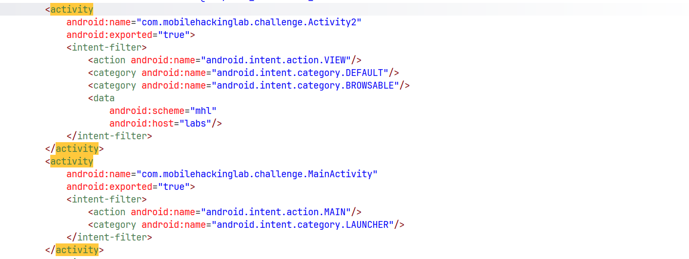
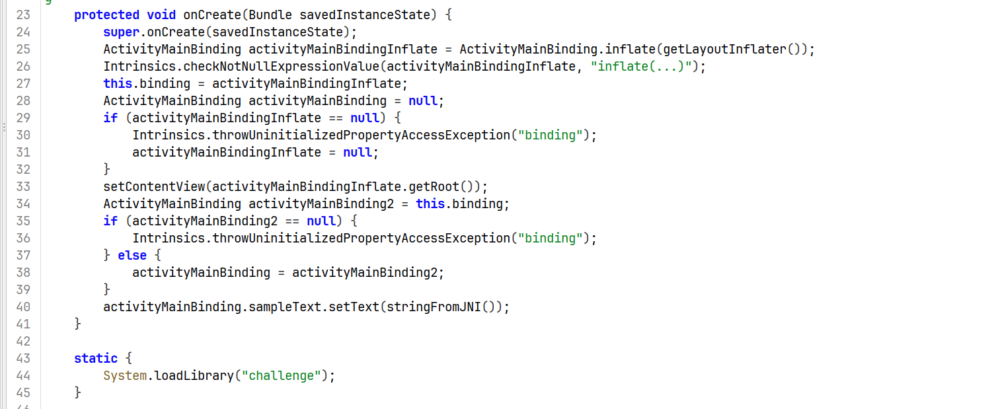
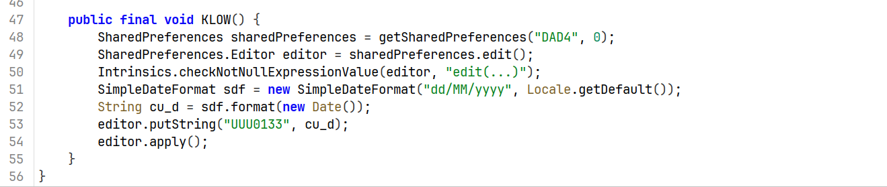
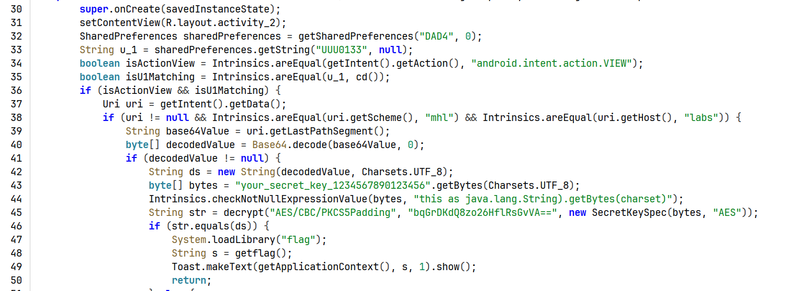
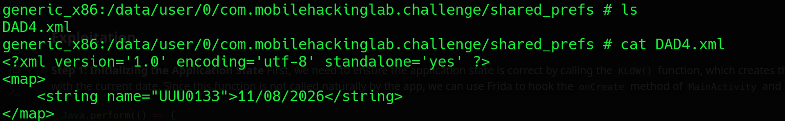
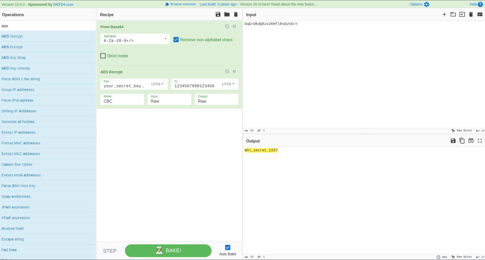
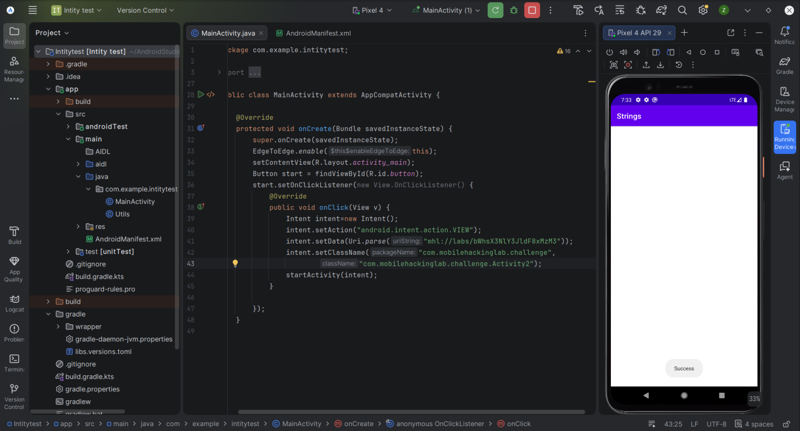
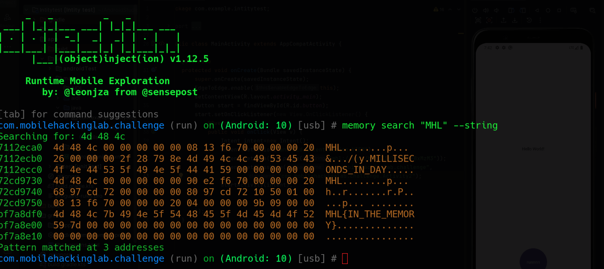
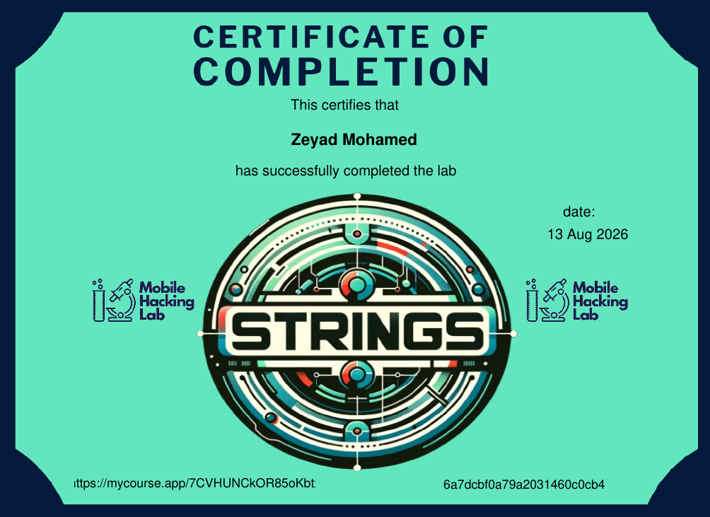

# Objective

The goal of this challenge was to exploit the application to obtain the flag.

# Static Analysis

Upon inspecting the `AndroidManifest.xml`, the application reveals two exported activities.

### Analyzing MainActivity

Starting the static analysis with `MainActivity`:


- **`onCreate()` Method:** The initial execution flow is straightforward. The method sets up the UI layout and immediately fetches a string from a native C/C++ library via the JNI function `stringFromJNI()`.
    

- **`KLOW()` Method:** Further inspection reveals a standalone method named `KLOW()`. When executed, this function creates an XML file within the `SharedPreferences` directory, storing the current date (specifically formatted as **`dd/mm/yyyy`**) under the key `"UUU0133"`.
    
    > **Note:** It is important to highlight that `KLOW()` is never actually called during the application's standard execution flow.


### Analyzing Activity2

 Method `onCreate()` enforces a strict sequence of checks:

 

- **Date Verification:** It retrieves the key `"UUU0133"` from `SharedPreferences` ("DAD4") and verifies it matches the current system date (`dd/MM/yyyy`).
    
    > **Note:** Because `MainActivity.KLOW()` never executes, this shared preference doesn't exist by default. It must be manually injected to bypass this check.   

- **Intent & Deep Link Validation:** The activity must be launched with the `android.intent.action.VIEW` action and match the specific URI structure: `mhl://labs`.
    
- **Payload Decryption:** It grabs the last path segment of the URI and Base64-decodes it. This decoded value must match a hardcoded ciphertext (`"bqGrDKdQ8zo26HflRsGvVA=="`) that the app decrypts using `AES/CBC/PKCS5Padding` and the static key `"your_secret_key_1234567890123456"`.
    

# Exploitation

**Step 1: Initializing the Application State** First, we need to ensure the application state is correct by calling the `KLOW()` function, which creates the required XML file (`DAD4.xml`) with the current date. Since this function is not called naturally by the app, we can use Frida to hook the `onCreate` method of `MainActivity` and force it to execute:
```js
Java.perform(() => {
    var MainActivity = Java.use("com.mobilehackinglab.challenge.MainActivity");
    MainActivity["onCreate"].implementation = function (savedInstanceState) {
        // Force call to KLOW method to set up SharedPreferences
        this["KLOW"]();
        this["onCreate"](savedInstanceState);
    };
});
```


Now that the script has run, the XML file is successfully created in the app's local storage.

**Step 2: Reversing the Cryptographic Payload** Next, we need to determine the correct string for the last path segment of our deep link URI. By analyzing the `decrypt` method, we can see it uses AES encryption in CBC mode. We already have everything we need from the decompiled source: the key, the ciphertext, and the IV (located in `Activity2Kt`).

Instead of writing a custom decryption script, we can simply pass these parameters into CyberChef to decrypt the ciphertext and reveal the secret plaintext.



After obtaining the decrypted secret, we Base64 encode it (`bWhsX3NlY3JldF8xMzM3`). This is the final string that will be passed into the URI path.

**Step 3: Triggering the Exploit** Now that all the prerequisites and checks are satisfied, it is time to start `Activity2`. We can do this by crafting a malicious Intent from a separate application (or via ADB) that explicitly sets the required Action and URI Data:

```java
Intent intent = new Intent();  
intent.setAction("android.intent.action.VIEW");  
intent.setData(Uri.parse("mhl://labs/bWhsX3NlY3JldF8xMzM3"));  
intent.setClassName("com.mobilehackinglab.challenge",  
        "com.mobilehackinglab.challenge.Activity2");  
startActivity(intent);
```


**Step 4: Memory Extraction** The activity starts successfully and displays a "Success" message on the screen, but the actual flag is not shown in the UI. The challenge hints that the flag is loaded directly into memory by the native library.

To retrieve it, we attach Objection to the running process and perform a direct memory search for the standard flag format:

```shell
memory search "MHL" --string
```


The memory scanner locates the string in the heap, successfully revealing the final flag!


# Impact

- **Unrestricted Access:** Because the activity is exported without permission checks, any malicious app on the same device can trigger it.

- **Exposed Secrets:** Hardcoding the AES key and IV in the source code completely defeats the encryption, allowing attackers to easily calculate the required bypass payload.
    
- **Unauthorized Code Execution:** By combining the exposed secrets with the exported activity, attackers can craft a specific Intent to bypass all security gates and force the app to run restricted native functions.
    
- **Real-World Consequences:** In a production application, these flaws could allow malware to silently bypass authentication screens, elevate privileges, or steal sensitive user data directly from memory.

# Mitigation

To secure the application against these attack vectors, the following defenses should be implemented:

- **Restrict Component Access:** If the activity does not need to be triggered by external applications, set `android:exported="false"` in the `AndroidManifest.xml`. If deep linking is required, implement robust permission checks or signature-level permissions to ensure only trusted applications can invoke the component.
    
- **Remove Hardcoded Secrets:** Never store cryptographic keys, IVs, or sensitive plaintext strings directly in the source code. Cryptographic material should be generated securely at runtime and stored in the **Android Keystore System**, which provides hardware-backed security and prevents extraction via static analysis.
    
- **Secure Intent Handling:** Do not trust data originating from external intents. Input validation should be performed strictly, and security decisions (such as executing native code) should not rely on easily manipulated client-side logic or easily predictable state files (like the current date in SharedPreferences).
    
- **Obfuscation and Anti-Tampering:** Implement root detection, memory protection, and native library obfuscation (such as O-LLVM) to significantly increase the difficulty of dynamic memory scanning and static reverse engineering.

# Conclusion

This challenge provided an excellent exercise in bridging static analysis with dynamic exploitation. While standard dynamic instrumentation techniques (like Frida logic bypasses) are highly effective against client-side boolean checks, this lab proved they fall short when data dependencies are enforced at the native layer.

By analyzing the decompiled code, extracting the cryptographic parameters, and recreating the payload externally, the intent routing checks were successfully satisfied. Finally, utilizing Objection for direct memory analysis proved to be a highly efficient way to extract the generated flag without needing to manually map and hook obfuscated JNI boundaries, showcasing a complete and practical mobile reverse engineering workflow.



